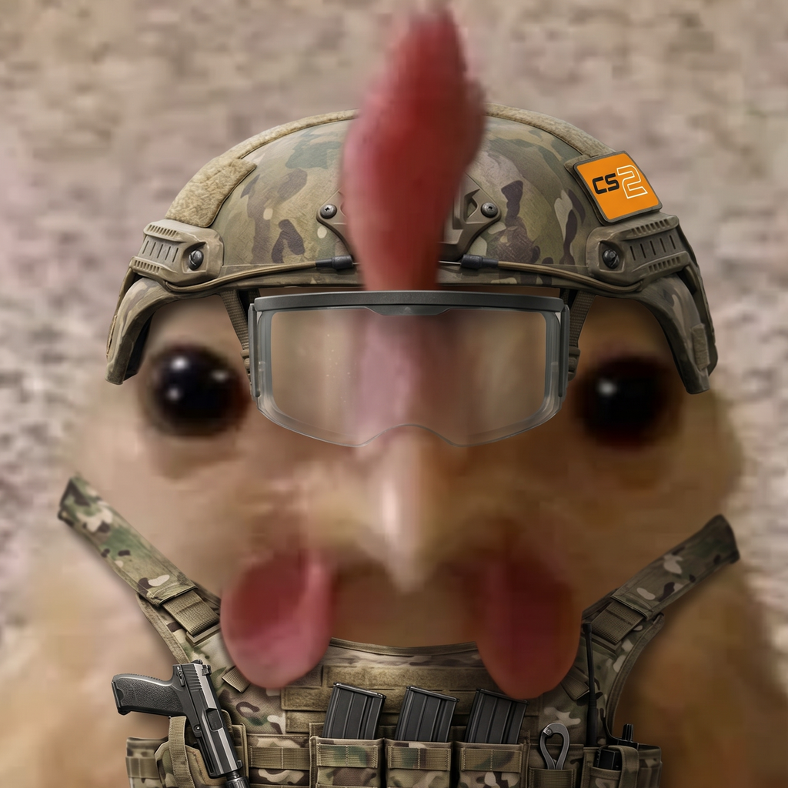

<div align="center">



# CS2 10-Man Bot

**Get ten players into a Counter-Strike 2 game without chasing anyone in the channel.**

[](https://github.com/rickymena/cs-ten-man-bot/actions/workflows/ci.yml)
[](LICENSE)


</div>

---

The bot posts one sign-up message with buttons. It keeps a first-come roster and a waitlist, and it pings the group with how many players are still needed until the game is full. When the game starts, it hands the confirmed ten the lobby link.

## Features

- **One-click sign-ups.** In, Maybe, Out, +1 Guest and -1 Guest buttons. The first ten "In" play; everyone else waits in order and moves up automatically, with a ping, when someone drops.
- **Countdown alerts.** A daily "need N more" while the game is short, another ping a few hours before start, one when the roster fills, and a "starting now" with the lobby link for the confirmed players.
- **Scheduling.** Save a game now and its sign-up posts by itself a few days ahead. Weekly series create each week's game on their own.
- **Plain-English times.** `sat 9pm`, `saturday at 9 PM`, `10/10 9pm`, `fri 9 ct`. The `when:` box previews how the bot read the time before you send it, and Discord shows everyone the time in their own zone.
- **Edits that keep the roster.** Move a game, rename it or change the slots without losing who signed up. Players pushed onto or off the waitlist are told.
- **Safe by default.** User text never pings anyone, every input is validated and escaped, and simultaneous clicks can't race. An alert is never posted twice, even across crashes and restarts.
- **Small footprint.** One process, SQLite and four runtime dependencies. Runs in a hardened, non-root container with daily verified backups.

## Commands

| Command | What it does |
|---|---|
| `/tenman start when: sat 9pm [lobby: https://...]` | Post a sign-up now. The organizer is added as In. |
| `/tenman schedule when: fri 9pm` | Save a game; its sign-up posts automatically 3 days before (`post_days:` to change). |
| `/tenman schedule when: fri 9pm repeat: weekly [weeks: 4]` | A weekly series; each week's sign-up posts by itself. |
| `/tenman list` | Everything coming up in the channel, numbered, plus weekly series. |
| `/tenman lobby url: https://... [number: N] [whole_series: true]` | Set a game's lobby link and ping its confirmed players. Works on scheduled games too. |
| `/tenman edit [number: N] [when:] [title:] [slots:] [post_days:] [lobby:]` | Change one game, posted or scheduled. Only the options given change; the roster is kept. |
| `/tenman update [series: S<id>] [when:] [title:] [slots:] [post_days:] [lobby:] [apply_to_next: true]` | Change a weekly series for the games it creates from now on. |
| `/tenman cancel [number: N]` | Cancel a game or stop a weekly series (asks to confirm). |

`edit`, `update` and `cancel` are limited to the game's organizer and moderators (Manage Messages). From the start time, clicks are refused, and the buttons are removed 30 minutes later.

## Quick start

### 1. Create the Discord application

1. Go to [discord.com/developers/applications](https://discord.com/developers/applications) and click **New Application**.
2. On the **Bot** tab, click **Reset Token** and copy the token. Leave every privileged intent **off**.
3. On **General Information**, leave **Interactions Endpoint URL** empty.
4. Invite the bot with this link, putting your application ID in place of `<APP_ID>`:
   ```
   https://discord.com/oauth2/authorize?client_id=<APP_ID>&scope=bot+applications.commands&permissions=216064
   ```
5. In the channel you'll use, make sure the bot has **View Channel, Send Messages, Embed Links, Read Message History** and **Mention Everyone**. It needs the last one only to ping a role that isn't mentionable.

Turn on Developer Mode (User Settings → Advanced), then right-click your server, channel and role → **Copy ID**. You need all three for the settings.

### 2. Configure

```sh
cp .env.sample .env
```

Fill in every value that starts with `PASTE_`. Everything is checked at startup, and a bad value stops the bot with a message that names it.

| Setting | Default | What it does |
|---|---|---|
| `DISCORD_TOKEN` | — | Bot token (**required**). In a container, use `secrets/discord_token` instead. |
| `GUILD_ID` / `CHANNEL_ID` | — | The server and the channel the bot works in (**required**). |
| `TENMAN_ROLE_ID` | unset | The role to ping in alerts. Leave it unset to post without pinging. |
| `TIMEZONE` | `America/New_York` | The zone that times like `sat 9pm` are read in. |
| `ALERT_TIME` | `12:00` | When the daily "need N more" alert goes out. |
| `GAMEDAY_ALERT_HOURS_BEFORE` | `2` | Hours before start for the game-day alert. |
| `TENMAN_SLOTS` / `TENMAN_MAX_GUESTS` | `10` / `1` | Roster size and the number of guests per player. |
| `SCHEDULE_POST_DAYS_BEFORE` | `3` | How early a scheduled sign-up posts. |
| `LOBBY_ALLOWED_HOSTS` | any | Optional allowlist of lobby-link domains, e.g. `popflash.site`. |
| `BACKUP_TIME` | `04:00` | When the daily database backup runs. |

The full list is in [`.env.sample`](.env.sample), including spam limits, healthcheck thresholds and paths.

### 3. Run

**Locally:**

```sh
python3 -m venv .venv
.venv/bin/pip install -r requirements.txt
.venv/bin/python bot.py
```

**On a server:** use rootless Podman (the default) or Docker. The bot runs as an unprivileged user, and the token is read from a file rather than the environment. [`guides/guide-deploy.txt`](guides/guide-deploy.txt) walks through it end to end, including optional GitHub Actions deploys on a version tag.

> [!WARNING]
> Never run two copies with the same token, say one on your PC and one on a server. Both would answer clicks and post alerts.

## How it works

- **One writer.** Every database write goes through a single queue (`utils/db_queue.py`), so two people clicking at the same moment can't corrupt the roster.
- **Positions are computed, not stored.** Each player's place is derived from the order they joined, so a drop moves the waitlist up correctly every time.
- **Alerts are claimed before they're sent.** An alert that a crash leaves in flight is marked ambiguous and never resent. You might miss one ping, but you never get it twice.
- **Input is untrusted.** Titles, lobby links and names are validated on the way in and escaped on the way out (`utils/sanitize.py`). Messages pass explicit `allowed_mentions`, so user text can't ping `@everyone`.

## Development

```sh
.venv/bin/pip install -r requirements.txt -r requirements-dev.txt
scripts/ci.sh            # lint, unit tests, simulated end-to-end runs, dependency audit
scripts/ci.sh --image    # also build the container and run the suite inside it
```

| Tool | Purpose |
|---|---|
| `devtool.py preview` | Post every message style through a webhook, with no pings and no bot needed |
| `python -m utils.backup [--verify F] [--restore F DEST]` | Back up, verify or restore the database |
| `tests/sim/` | End-to-end runs that drive the real callbacks against a fake Discord |

Contributions are welcome. See [CONTRIBUTING.md](CONTRIBUTING.md), and report security issues privately as described in [SECURITY.md](SECURITY.md).

## License

[Apache License 2.0](LICENSE). Counter-Strike 2 is a trademark of Valve Corporation. This project is not affiliated with Valve or Discord.
